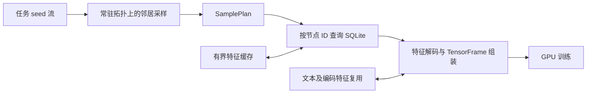
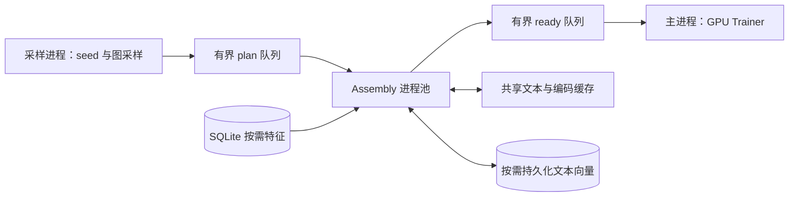

# RelConnector 优化演进报告：从 vanilla、v1 到 v2

## v1 与 v2 的区别

v1 是基于单进程的数据准备优化版本，通过节点去重、跨批次窗口、缓存复用和进程内线程流水线减少重复读取与编码。实际训练进一步暴露出 assemble（特征读取、编码与批次组装）的供给瓶颈：即使减少重复工作，数据准备仍可能跟不上 GPU 消费。v2 因此升级为多进程架构，将采样、assemble 和训练拆分为独立的执行阶段，分别由采样进程、组装进程池和训练主进程承担，通过有界队列连接并重叠执行。这里的单进程不等于单线程，多进程也不改变邻居采样与模型训练的算法语义。

报告日期：2026-09-26。以本次整理时的工作区源码、实验文档和原始 JSONL 为依据；工作区含尚未提交的改动，因此这里的“当前实现”不是某个已发布 Git tag。本文没有重新启动训练或改变正在执行的实验。

本文的核心问题是：**在不能把全量业务特征一次加载到内存的机器上，怎样保持关系图训练语义，并提高在线训练吞吐。** 正式比较对象为 vanilla、v1、v2。batch 只用于解释传统全量物化训练方式，不进入性能排名、加速比或总体统计。

## 1. 结论与版本定位

这几轮优化可以归纳为四次问题重心的转移：

1. **vanilla 建立按需训练路径。** 图拓扑常驻，训练节点特征按采样结果从 SQLite 读取，使训练不再依赖全量特征物化。
2. **v1 减少重复工作。** 先修复查询路径，再通过节点去重、跨 batch 窗口、文本缓存消除重复读取和编码，随后增加最终编码特征缓存、直接 GloVe 执行和线程流水线。
3. **v2 提高特征生产并行度。** 将采样、组装、GPU 训练拆到不同进程，用共享缓存和有界预取提高供给能力，并通过磁盘文本缓存复用内存容纳不下的 embedding 工作集。
4. **v2 后续修复降低复用本身的成本。** HM 暴露整块缓存传输，Salt 暴露高命中路径锁开销，Stack 暴露共享查询及 mmap 资源耗尽，Amazon 暴露 WAL 回收和小分片写入成本。优化对象从“少编码”扩展为“低成本复用、可持续长跑”。

现有证据支持上述演进方向，但不能据此宣称 v2 在全部任务上优于 v1，或者已经完成严格的低内存验收。当前成功记录覆盖 8 个代表任务；Event、Trial 的历史跨实验耗时比较仍退化，Amazon、Ratebeer 尚无本次矩阵的成功完整结果。

### 1.1 名称与实际代码的对应关系

| 名称 | 当前代码位置（相对项目目录） | 本文角色 |
| --- | --- | --- |
| vanilla | `baseline/vanilla_baseline/` | 未引入后续系统优化的在线基线 |
| v1 | `relconnector/` | 上一代优化实现，包含多轮特征路径优化 |
| v2 | `relconnector_v2/relconnector_v2/` | 当前最新实现，独立命名空间与多进程运行时 |
| cache | `baseline/cache_baseline/` | 冻结早期 v1，用于追踪缓存优化阶段，非新增主比较对象 |
| batch | `baseline/batch_baseline/` | 全量读库、编码与 TensorFrame 物化的传统训练方式，仅作背景 |

“vanilla 未优化”是相对于后续优化而言，不能理解为没有任何缓存和异步能力。当前 vanilla 已有稀疏/稠密混合 SQL 读取、raw block cache 和线程执行器；它没有 v1 的跨窗口复用体系，文本仍直接调用官方 `encode`，不维护后续整句向量缓存。

另外，历史报告中的 v1 是当时最新代码，**并不总是现在 `relconnector/` 目录的代码**。十库历史 GPU 表记录的是早期缓存优化版，之后还有正确性修复和动态特征优化。本文称这张表为“历史 v1”，不将其成绩冒充当前 v1 的实测。

### 1.2 研究边界

系统仍将图拓扑保存在内存中。因此它降低的是全量业务特征及编码特征的内存需求，并未解决任意规模图拓扑都超出内存的问题。batch 虽然同样可按 mini-batch 更新模型，但其特征准备是全量物化；它与本项目的内存约束不同，不作为正式对照。

早期文档要求不持久化 dense embedding；当前 v2 已加入按访问惰性生成的磁盘文本向量缓存。这是存储策略的演进：没有在训练前一次性把全表特征载入 RAM，也没有预生成全部采样训练集，但会保留访问过的文本向量，长期访问后可能覆盖很大的文本工作集。新报告应明确计入磁盘成本，不能沿用“只持久化拓扑和统计量”的旧描述。

## 2. 基础架构与瓶颈如何形成

### 2.1 在线路径



采样给出需要的节点、边和时间信息；特征读取只处理实际请求；训练端接收已准备的 batch，不直接操作 SQL。`BatchKey(epoch, batch)` 标识任务批次，`SeedBatch → SamplePlan → FeatureBatch → PreparedBatch` 将数据语义与队列调度分离。

这个设计节省内存的代价，是把传统训练前一次完成的特征处理转移到了训练循环中。相同节点和文本可能被多次采样，每次都经历读取、字符串处理、编码和组装，最终 GPU 等待 CPU 供给。

历史瓶颈分析中，Amazon、Arxiv、Stack 的 ready 等待分别约占训练时间的 97.3%、89.0%、86.5%。这些数据属于历史版本，作用是说明优化的选题依据，而不是当前性能。它们表明当时应优先优化特征路径，而不是先改 GNN kernel。[来源：瓶颈分析](bottleneck-analysis-and-optimization.md)

### 2.2 性能分析方法

稳态下，可用下式理解瓶颈，但不能将其当作实测计时公式：

```text
每 batch 流水线间隔 ≈ max(采样供给间隔, 特征生产供给间隔, GPU 消费间隔)
总时间 ≈ 初始化 + 流水线填充 + 稳态执行 + 排空/退出
```

并行 worker 的累计时间及嵌套操作时间不能直接相加得到 wall time。判断优化是否有效，应同时查看端到端时间、pipeline 时间、ready 等待和具体阶段服务时间。高 cache hit rate 只说明避开了部分计算，并不说明查询、复制、索引和锁的总成本很低。

## 3. 第一轮：vanilla 到早期 v1——消除冗余读取与编码

### 3.1 修复 SQL 查询退化

无显式主键的表对外使用零基 node ID，对 SQLite 则使用一基 rowid。旧路径把 `rowid - 1` 放入筛选/排序表达式，可能破坏直接 rowid 查找路径。修复后在查询边界转换 ID，筛选和排序保留裸 rowid：

```sql
SELECT rowid - 1 AS __node_id__, ...
FROM table_name
WHERE rowid IN (...)
ORDER BY rowid;
```

这里的收益是避免本来只请求少量节点却扫描大量数据。后续还建立了显式连续 node ID 的离线契约。**当前 vanilla 已回补 rowid 修复**，所以历史包含此缺陷的 vanilla 结果不能直接代表今天的 vanilla。历史复现需使用修复前归档。[来源：特征优化计划](feature-pipeline-optimization-plan.md)、[正确性修订](cache-baseline-correctness-report.md)

### 3.2 批内及跨分支节点去重

对同一张表，将重复请求的节点 ID 合并，只读取和编码一次，再按 inverse index 恢复采样器要求的顺序与重复项。推荐任务的 source、positive、negative 分支也可合并静态特征请求。

例如请求 `[7, 3, 7, 8]`，特征生产只处理唯一节点，再恢复为四个位置。去重的是特征生产工作，没有删除训练节点、图边或任务样本；时间相关表示仍须按各自 seed time 计算。

### 3.3 跨 batch feature window

将相邻几个 batch 的特征请求统一处理，复用同一窗口内的节点读取、解码和编码。早期实验采用 4 batch、512 MiB 的窗口上限。它适合有重复实体或共享维表的采样，但较大窗口也会增加首批延迟、临时内存和 inverse 恢复工作。

窗口是特征生产单位，不能跨 epoch 混合后直接交给要求单 epoch 的 fetcher；跨 epoch 预取必须保持不同 epoch 的窗口分离。

### 3.4 原始行缓存与文本向量缓存

raw block cache 保存解码后的 DataFrame 块，稠密访问可读整块，稀疏请求使用合并 `IN` 查询以避免大规模过读。文本层将 normalized text 映射到 300 维 GloVe 向量，调用内去重，并跨调用复用。

它们消除不同的成本：raw 命中省 SQL/解码，文本命中省文本模型执行；两者都不能完全省掉 TensorFrame 构造与按采样顺序展开。缓存须按实际持有的存储计费：缓存一个 tensor 的行 view 可能保留整个原始 batch 的 backing storage，这一问题后来通过独立存储及 slab 设计处理。

### 3.5 为什么任务收益差异很大

历史 Salt 的节点重复因子为 2.114、raw 行覆盖率为 98.70%；Stack 的重复因子只有 1.011、raw 行覆盖率仅 4.86%。前者能明显受益于节点级复用，后者更多依赖文本复用。历史 Stack 的文本 LRU 仍发生约 4,390 万次淘汰，说明小内存整句缓存无法容纳其工作集。

| 历史任务 | vanilla 单轮 wall | 早期 v1 单轮 wall | 历史观测 |
| --- | ---: | ---: | --- |
| Salt | 14,132.8 s | 2,832.6 s | 4.99× |
| Stack | 7,831.8 s | 6,428.7 s | 1.22× |
| Arxiv | 4 小时内未完成 | 2,855.0 s | 由超时转为完成 |
| Avito | 4 小时内未完成 | 1,195.8 s | 由超时转为完成 |
| HM | 4 小时内未完成 | 1,743.1 s | 由超时转为完成 |
| Amazon | 4 小时内未完成 | 13,898.2 s | 在预算内完成 |
| Ratebeer | 4 小时内未完成 | 4 小时完成 15,686 / 20,743 batch | 吞吐仍不足 |

这些是正确性修复前的演进证据，不是当前三个版本的正式成绩。timeout 不能当作完整 epoch 的精确耗时。历史 v1 九项完成，Ratebeer 超时；该轮观测 RSS 均低于 10 GiB，Ratebeer 数值只是终止前峰值。[来源：历史 GPU 特征实验](gpu-feature-optimization-experiment.md)

## 4. 正确性修订：保证优化的是执行方式

在进一步优化前，项目冻结早期 v1 为 cache baseline，并回补目标隐藏、官方 stype 抽样和读取 dtype 等问题。修订版本标识为 `relbench-correctness-v1`。

关键约束包括：

- 各在线版本读取同一份离线固化的官方 stype artifact，不能为了加速将长文本、URL、邮箱随意改成 categorical/hash 或删除。
- autocomplete 按任务语义隐藏目标；Ratebeer external 中直接作为 label 的字段按勘误隐藏。forecast 的历史同名观测不能仅因列名相同就删除。
- 固定输入下检查节点/边顺序、缺失值位置、TensorFrame、forward、loss 和更新后的参数，而非仅比较最终平均 loss。
- 缓存仅保存静态特征及冻结文本编码结果，不保存会随训练更新失效的 HeteroEncoder/GNN 隐状态。

历史记录包含四版本固定 fixture 的逐值一致，以及真实 F1 推荐 SamplePlan 的 60 组特征和结构一致。它们证明已覆盖的契约，不等于所有任务、多 GPU 和所有调度配置都通过了完整验收。历史修复前后的 loss 和耗时应分开使用。[来源：正确性修订报告](cache-baseline-correctness-report.md)

## 5. 第二轮 v1：从缓存原始输入到缓存最终特征

### 5.1 Encoded TensorFrame cache

仅缓存文本向量时，命中后仍需做 DataFrame prepare、列 mapper、converter 和 inverse gather。encoded cache 将复用层提升到最终静态 CPU TensorFrame，以 `(table, node_id)` 查找，整块持有特征，编码 miss 后恢复原始次序。

缓存按 tensor storage、ID tensor 和索引成本计费；超大项拒绝进入。有容量时可直接准入，在容量或低复用压力下采用二次访问准入，让大量只出现一次的事实表行少挤占热点维表。

### 5.2 同语义 GloVe direct 路径与连续 slab

GloVe 的冻结句向量来自 tokenizer、WordEmbeddings 和 mean Pooling。direct 路径调用已加载的这些官方模块，避开通用 `SentenceTransformer.encode` 调度；结构不符合预期时回退官方路径。缓存使用连续 Tensor slab 和槽位，减少大量小 Tensor 对象与独立 storage。

已有固定文本测试覆盖空值、OOV、标点、大小写和长文本，direct 与 official 输出逐值相等。256 条文本、20 轮微基准由 0.2123 s 降到 0.1334 s，局部约 1.59×。这是局部路径加速，不能当作整项训练加速；也不能把旧计划中的独立 token cache 视为已经全面实现。

### 5.3 线程流水线、自适应窗口和初始化复用

v1 将 SQL fetch 与 encode 分离，支持 1/2 encode worker，并按 BatchKey 顺序消费。动态窗口根据重复因子、raw-cache coverage 的 EWMA 决策，使用滞回、冷却和 byte/batch 上限，避免在低重复工作集上持续做无收益去重。

schema statistics 和纯拓扑按数据库版本、cutoff、隐藏列、stype、算法参数持久化；命中前仍校验 artifact。它降低重复启动成本，适合 Event 一类训练很短而初始化很长的任务。

这一代仍是线程架构。采样器使用全局 RNG 时，采样与训练需通过保护避免互相污染，因而不能获得完全独立的采样/训练并行。

### 5.4 已有消融证据

| 实验 | 对照 | 优化 | 可支持的结论 |
| --- | ---: | ---: | --- |
| F1 CPU 22 batch 训练 | 5.4020 s | 5.4846 s | 小任务约退化 1.5%，多 worker 非普遍收益 |
| Salt GPU 2×50 batch 训练 | 213.58 s | 140.99 s | 组合优化减少约 34.0% 训练耗时 |
| Ratebeer GPU 2×20 batch 训练 | 57.77 s | 52.83 s | 组合优化减少约 8.5% 训练耗时 |
| Salt CPU 初始化冷/暖 | 29.87 s | 5.66 s | 初始化复用减少约 81% 耗时 |

Salt/Ratebeer GPU 实验组合了 direct、多 worker、encoded cache 等改动，不能拆解成单项收益；它们也只覆盖短程。该轮 Salt 优化峰值 RSS 为 17.15 GiB，已经说明“早期 v1 均低于 10 GiB”不能套用于所有后续配置。CPU 固定输入一致，CUDA 短回归仍有超过历史严格阈值的 loss 差异，不应直接放宽容差后宣告数值等价。[来源：动态特征优化报告](adaptive-feature-optimization-report.md)

## 6. 第三轮 v2：三阶段多进程与多层复用

### 6.1 进程边界围绕 CPU 特征生产设置



每个 Assembly worker 自己持有 SQLite reader、raw cache、GloVe 和 TensorFrame 转换器。Pandas frame 与原始字符串留在 worker 内，训练端接收准备好的 tensor；拓扑 tensor 进入共享内存，prepared tensor 使用 PyTorch multiprocessing transport。

v2 不是把 v1 的 SQL、encode 两段各自机械地扩成进程池，而是让一个组装进程完成一段窗口的读取到编码，减少传输 Python 数据对象。代价是 worker 自身的模型、连接、临时工作集和进程资源需要单独计入预算。

### 6.2 有界队列、inflight 与动态激活

seed/plan/ready 队列按字节计费，并限制未完成窗口，防止生产端无限超前。进程预先 spawn，再通过许可控制活跃数量：ready 饥饿时增加活跃 worker，ready 高水位时减少活跃 worker。当前代码的高水位判断为 ready 字节容量的 75%。

需要区分“减少活跃工作”与“释放进程内存”：预先创建的进程并不因为暂停工作就退出，持有的模型和缓存也不会自动全部释放。动态激活主要调整供给与竞争，不能单独作为内存自适应证明。

### 6.3 strict 与 ready 顺序

`strict` 按序号消费，便于确定性对照，但慢窗口会阻塞后续 batch。`ready` 在当前 epoch 内消费已就绪 batch，缓解队头阻塞；epoch gate 保证不会提前训练下一轮。跨 epoch 预取允许下一轮提前准备，但窗口本身仍按 epoch 拆开。

默认 ready 会改变优化器看到 batch 的先后，进而影响训练轨迹。因此“样本和特征语义不变”不意味着最终参数或 loss 逐位一致。正式因果比较应先用 strict 固定顺序，再单独报告 ready 的吞吐/收敛影响。

### 6.4 共享文本缓存：避免进程间重复编码

多个 worker 可能同时遇到相同文本。共享 reservation 让一个 worker 负责 miss 的编码与发布，其他 worker 等待或读取已发布向量，减少重复模型工作。共享向量槽发布后在运行期保持不可变，为后续锁外 gather 和本地位置索引提供了条件。

共享 encoded cache 则复用更上层的 TensorFrame，由集中索引管理。它不等于“零成本访问”：manager RPC、结果搬运和重建都可能成为新瓶颈，HM 后续修复就是这一点的实际证据。

### 6.5 磁盘文本缓存：扩大可复用工作集

当文本工作集超过内存缓存，持续淘汰会导致跨 batch/epoch 重复编码。v2 使用 SQLite 索引和 float32 向量分片持久化已访问文本，命名空间包含数据库版本、模型身份和编码路径等信息。

默认 adaptive 的激活条件包括：数据库至少 256 MiB，已处理至少 4,096 条模型输入，模型耗时至少 1 s，内存命中率不高于 10%。这些阈值是当前启发式参数，不是对所有数据分布都最优的理论界限。小任务可以完全不启用磁盘缓存。

Arxiv 2×50 batch 记录中，off 为 204.7 s，warm 为 190.5 s，暖缓存约快 6.9%，模型输入由 574,119 降为 0；cold 为 396.6 s。模型输入归零并没有让 wall time 同比例下降，因为 frame conversion、查询与展开还在。cold 同时包含首次初始化及写入成本，不能将 cold/warm 的 2.08× 全部解释为编码优化。[来源：磁盘缓存实验](v2-disk-text-cache-experiment-20260925.md)

## 7. v2 的四类退化及修复思路

### 7.1 HM：缩小缓存传输粒度，保留本地缓存选项

HM 的热点 `article` 缓存命中率达到 99.77%，原实现却通过 manager RPC 返回整块 TensorFrame，即使调用方只需要少量行。缓存越满，第二轮跨进程传输和重建越重。

修复先让共享缓存只返回命中行，再提供 worker 本地 encoded cache。500 batch×2 的总时间依次为：原共享 2 GiB 206.0 s、仅传命中行 183.5 s、本地总计 2 GiB 157.7 s、本地总计 4 GiB 152.8 s。等预算的中间对照支持通信成本的判断；最终完整结果还包含容量改变。

完整两轮 pipeline 从 4,603.0 s 降到 1,756.3 s，约 2.62×；ready 等待从 3,348.9 s 降到 481.9 s。端到端 5,050.8→1,760.1 s 的 2.87× 还包含初始化由冷变暖。文本编码与 SQL 执行量基本不变，改善主要来自缓存传输路径。

当前矩阵仍显式给 HM 选择 local encoded cache、总计 4 GiB；其他任务通常 shared 2 GiB。**文本策略已统一自适应，不代表 encoded 缓存策略也已完全消除数据集特配。** [来源：HM 回归报告](v2-hm-regression-20260925.md)

### 7.2 Salt：命中后绕过共享锁，不复制整份向量缓存

Salt 修复前共享文本命中约 99.93%、第二轮模型编码为 0，但 ready 等待占流水线约 90%。耗时来自大量重复的跨进程查询，而不是模型执行。

最初本地向量缓存短测证明省锁比减少重复编码更重要。最终默认策略保留共享向量和 reservation，仅在 worker 本地维护“文本→已发布共享槽”的有界索引。命中时直接 gather，不再重新哈希、获取共享锁；返回 tensor 有独立存储。

索引依据实际命中率和查询成本激活，低复用时释放，并用滞回/冷却减少反复切换；每 worker 约 32 MiB 的估算元数据预算。F1 不激活，Arxiv 部分 worker 激活后因低复用退出，说明策略不依赖数据集名称。

最终 Salt 完整两轮 6,340 batch：18,260.23→5,208.23 s，约 3.51×；模型输入保持 146,635/0。相对历史 v1 的单位 batch 观测仅约 1.088×，不能把修复旧 v2 的 3.51× 写成对 v1 的加速。修复后 ready 仍占 pipeline 约 64.7%，frame gather 和 encoded cache 路径仍有空间。[来源：Salt 回归报告](v2-salt-regression-20260926.md)

### 7.3 Stack：共享访问批量化，并给 mmap 与错误通道设边界

Stack 的共享向量缓存填满后，旧查询逐槽调用 PyTorch 标量操作，锁内逐条 clone 和 publish，使大量未命中/拒绝也变成昂贵操作。修复将哈希移到锁外，元数据改为零拷贝 NumPy 视图，在锁内只确定不可变槽地址，锁外批量 gather；发布也批量处理，并给取锁设置截止时间。

100 batch 短测由 296.04 s 降至 53.45 s，约 5.54×。后测复用了少量新写入 embedding，存在同机负载干扰，因此不能把差值全归因于单项改动；原版模型编码仅 0.74 worker 秒，而共享查询达 739.45 worker 秒，支持查询为主要瓶颈。

之后的长跑又暴露独立问题：分片 memmap 无上限，文件描述符与映射数持续增长，逼近系统映射上限。资源耗尽时，原错误队列还需新建 feeder 线程，可能连错误都无法发出，形成训练等 ready、worker 等清理信号的停滞。

修复将每 cache 的映射限制为 1,024 个 LRU，关闭旧映射但不删除向量；调用方拿到的是独立副本。错误传输改为无需临时启动线程的同步通道，同时补 seed 读取异常传播及完成状态检查。

最终完整 13,228 batch 用时 3,665.66 s；各 worker 映射数保持有界并正常退出，跨过旧挂起位置。该运行使用已有磁盘缓存，模型输入为 0/6,942。大量重开映射仍有 I/O 成本，所以“LRU 防止资源耗尽”与“磁盘布局足够高效”是两个问题。早期未取得调用栈的原停滞不能一概认定为已确认死锁。[来源：Stack 回归报告](v2-stack-regression-20260926.md)

### 7.4 Amazon：控制 WAL 增长，同时避免过度 checkpoint

Amazon 大量首次文本写入导致 WAL 增长至约 60.46 GB；不断创建小分片又增加文件管理开销。修复改为每 writer 独占、每片 8,192 行的固定分片追加，SQLite 只发布已经写好的向量位置。

仅设固定 64 MiB WAL 阈值也失败：机械盘频繁刷稀疏脏页，checkpoint worker 阻塞，其余 writer 等锁，出现长时间无 batch 输出。最终采用随索引大小和可用空间变化的阈值，通常在 64 MiB–4 GiB，并受剩余空间比例约束；超阈值尝试 TRUNCATE。它是回收触发值，不是外部长事务持锁时的绝对上限。

独立空文本缓存 2×100 batch 完成于 676.01 s，WAL 观测峰值约 1.35 GiB，退出时归零。这证明该短程的写入和回收能够完成，尚非完整 Amazon 的最终加速结论。续跑主缓存已合并到 6,584,936 条向量，因此后续结果属于部分热缓存运行。[来源：Amazon 回归报告](v2-amazon-regression-20260926.md)

## 8. 当前结果总览与证据强度

### 8.1 原始记录优先于旧汇总

本次读取 `benchmarks/v2-full-matrix-20260925/v2.jsonl` 得到 10 条成功记录，包含 HM、Salt 各一次旧结果和一次修复结果，对应 8 个不同任务。本表每任务取最后一条成功记录。状态文件快照时间为 2026-09-26 15:52:43（UTC+8），记录 Amazon、Ratebeer 尚缺成功结果；这是文件快照，不是对后台实时进程存活的断言。

旧 `v2-full-matrix-20260925-final.md` 标题虽含 final，但只总结早期 5/10 状态，不能作为当前完成度依据。另一方面，8 个任务也不是同一个最终代码快照全部重跑所得：部分任务在后续修复前已经完成，应视为“演进期间最新成功记录集合”。

### 8.2 跨历史实验的描述性比较

以下不含 batch。历史 v1 来自早期单 epoch GPU 报告，v2 为两个 epoch，常用 batch 512、fanout 128×128、channels 128。比值计算为：

```text
观测速度比 = (历史 v1 wall / 历史 batch 数)
             / (v2 wall / v2 实际完成 batch 数)
```

大于 1 表示 v2 在这两组记录中的平均单位 batch 时间较低。硬件（历史 A30、v2 文档中的 RTX 4090）、正确性版本、初始化/磁盘缓存、ready 顺序、worker 配置和系统负载均可能不同，**这张表用于发现趋势和回归，不能作为正式同条件加速结论**。相同 batch 数也不能保证正确性修复前后的输入列和特征工作量相同。

| 任务 | 历史 v1 单轮 wall（s） | v2 完成 batch | v2 两轮 wall（s） | v2 s/batch | 历史 v1 / v2 | 状态说明 |
| --- | ---: | ---: | ---: | ---: | ---: | --- |
| Amazon / item-churn | 13,898.2 | — | — | — | — | 只有修复短测；矩阵完整结果待补 |
| Arxiv / paper-citation | 2,855.0 | 2,088 | 981.64 | 0.47013 | 5.817× | 已有部分磁盘 embedding |
| Avito / searchstream-click | 1,195.8 | 8,644 | 1,604.83 | 0.18566 | 1.490× | 两轮完成 |
| Event / user-attendance | 966.1 | 76 | 2,193.96 | 28.86783 | 0.881× | 初始化/流水线外成本主导 |
| F1 / driver-circuit-compete | 15.9 | 12 | 26.57 | 2.21388 | 1.197× | 小任务，启动摊薄影响大 |
| HM / user-churn | 1,743.1 | 14,972 | 1,760.13 | 0.11756 | 1.981× | 本地 encoded 4 GiB，初始化已暖 |
| Ratebeer / beer_ratings-total_score | 4 小时超时 | — | — | — | — | 不能计算完整 epoch 加速比 |
| Salt / item-incoterms | 2,832.6 | 6,340 | 5,208.23 | 0.82149 | 1.088× | 修复后 adaptive，无磁盘文本缓存 |
| Stack / user-badge | 6,428.7 | 13,228 | 3,665.66 | 0.27711 | 3.508× | 修复后完整结果，已有磁盘缓存 |
| Trial / eligibilities-adult | 260.2 | 918 | 656.95 | 0.71563 | 0.792× | 当前记录仍退化 |

来源：[原始 v2 JSONL](../benchmarks/v2-full-matrix-20260925/v2.jsonl)、[历史 v1 表](gpu-feature-optimization-experiment.md)。历史表引用的早期原始 JSONL 本次工作区未见，因此历史数字只能追溯到保留的报告，不能声称已逐条核验早期原始遥测。

Event 的 pipeline 仅 27.45 s，流水线外约 2,166.51 s，继续增加 Assembly 并行度不会解决主要端到端问题。Trial pipeline 529.54 s、ready 等待 383.82 s，说明特征供给仍占明显成本，但现有数据不足以将其退化归因于某一个组件。

不计算“十任务总体平均加速”：两项缺失、版本和缓存状态混合，且任务权重不同。Ratebeer 矩阵配置还限制每 epoch 最多 10,000 batch，而历史完整 epoch 为 20,743 batch；将来即使达到该上限，也须标为截断工作量。

## 9. 有限内存目标：已有机制与尚缺的验收

### 9.1 总内存必须覆盖整个进程树

当前 v2 benchmark 的内存字段来自：

```python
resource.getrusage(resource.RUSAGE_SELF).ru_maxrss / 1024
```

它只统计调用进程自身。Assembly worker、采样进程、缓存 manager 的独立占用没有汇总进去。因此表中主进程约 2–4 GiB 的结果**不能代表 v2 总内存，也不能与历史单进程 RSS 直接计算内存节省比例**。[源码：benchmark.py](../relconnector_v2/relconnector_v2/benchmark.py)

合理预算应覆盖：

```text
拓扑与其构建临时内存 + schema/词表/模型
+ 所有 worker 的私有内存与临时工作集
+ raw/text/encoded 缓存及索引元数据
+ 队列、在途窗口、重排等待数据和传输缓冲
+ GPU 模型/优化器/激活 + 系统与文件缓存余量
```

直接相加各进程 RSS 又会重复计算共享页，宜同时采集进程树 PSS/USS、共享内存及受限容器/cgroup 峰值，并说明统计口径。

### 9.2 默认预算不是“小内存已达标”

当前配置允许 raw 4 GiB、encoded 2 GiB、文本 512 MiB、plan 2 GiB、ready 16 GiB、seed 64 MiB；HM encoded 总计 4 GiB。进程路径将 raw 和本地缓存预算按 worker 数分配，而共享缓存使用统一总预算，不能把这些容量错误地再乘一遍 worker 数。

但每 worker 的 GloVe、Python/SQLite 状态、临时转换和本地位置索引仍额外占用。队列上限不是启动即分配的实际内存，也不是全系统峰值硬上限；ready 队列消费后的等待对象和 inflight 工作也应纳入测量。当前默认 16 GiB ready 容量尤其不应未经验证直接当作 16/32 GiB 机器的部署配置。[源码：config.py](../relconnector_v2/relconnector_v2/config.py)、[process_api.py](../relconnector_v2/relconnector_v2/process_api.py)

### 9.3 磁盘是新增资源维度

300 维 float32 向量仅 payload 就约 1,200 B/条；100 万条约 1.12 GiB，尚不含 SQLite 索引、WAL、分片空位和元数据。这只是容量估算。mmap LRU 限制打开的映射数量，不限制磁盘向量总量；WAL checkpoint 控制日志回收，不回收已保留的 embedding。

因此应同时报告磁盘缓存初始/最终条目与字节、WAL 峰值、checkpoint 等待、文件数、FD/mmap 峰值及磁盘吞吐。持久化缓存对多 epoch 有价值，但其磁盘增长和长期清理策略仍需独立验收。

## 10. 下一轮正式实验如何组织

本节是依据现有缺口提出的实验设计，本次整理没有执行这些训练。

### 10.1 主对照只保留三个在线版本

固定当前 vanilla、v1、v2 的源码快照、数据库版本、官方 stype、隐藏列、模型、采样参数、种子、硬件和 CPU 线程配置，在同一总内存限额下运行。缓存容量和 worker 数可以不同，但必须遵守相同资源约束并披露配置。cache baseline 可用于阶段消融，batch 不进入主对照。

主指标应为：能否在限额内完成、OOM/timeout、实际样本与 batch 数、端到端时间、逐 epoch 时间、稳态 examples/s、进程树内存峰值、显存和磁盘代价。任务更改过特征隐藏时，必须使用修订后的同一输入语义重跑。

### 10.2 冷启动与复用分开计费

| 组别 | schema/topology | 磁盘文本向量 | 回答的问题 |
| --- | --- | --- | --- |
| 全冷 | 新目录 | 新目录 | 首次部署总成本 |
| 初始化暖、文本冷 | 已存在 | 新目录 | 首次遇到文本工作集的构建代价 |
| 热缓存 | 已存在 | 记录初始条目/字节 | 重复训练和多轮复用收益 |

各配置使用独立缓存目录或完全相同的初始缓存副本，不能让后测默默继承前测填充的缓存。至少两轮记录逐轮时间；完整 epoch 和每轮前 N batch 的短测分开报告。重复运行给出中位数及波动，避免把约 2% 的单次差值解释为稳定收益。

### 10.3 最有信息量的消融

| 问题 | 固定条件下的对照 | 关注指标 |
| --- | --- | --- |
| 多进程是否真正有效 | v2 1/2/4 worker，相同总预算 | ready 等待、吞吐、内存、CPU/I/O 饱和度 |
| 调度收益是否来自改序 | strict / ready | 样本覆盖、顺序、收敛及吞吐 |
| 最终特征复用是否值得 | encoded off/shared/local，等容量 | 少编码量、RPC/复制成本、wall |
| 高命中文本为何仍慢 | shared / adaptive local index | 模型输入不变时的查询成本 |
| 磁盘缓存能否摊销 | off / 文本冷 / 热 | 首轮开销、多轮总成本、磁盘增长 |
| 初始化是否主导 | 冷 / 暖 artifact | prepare、首 batch 延迟、pipeline |
| 大窗口是否有效 | static / adaptive window | 重复率、峰值内存、首批延迟 |

优先完成 Amazon、Ratebeer 的明确工作量验证；对 Event/Trial 做阶段诊断；对 Salt 继续看 frame gather 和 encoded RPC；最后在统一最终代码上重跑已完成任务。HM 的 encoded 特配可保留为披露的实验配置，但若要声称普适自适应系统，还需要将 local/shared 的选择转为可验证的运行时策略。

## 11. 可用于项目说明的核心表述

RelConnector 的优化围绕有限内存下的在线特征供给展开。vanilla 用按需 SQL 特征读取替代全量特征驻留；v1 用节点去重、窗口合并及多层有界缓存降低重复工作；v2 用采样—组装—训练多进程流水线提高生产能力，并用共享及持久化文本缓存扩展复用范围。后续针对共享查询、跨进程复制、映射资源和 WAL 的修复，使缓存命中更便宜、长时间运行更可控。

当前最有力的证据是按瓶颈定位的局部对照与完整修复回归，而不是一个统一的“全面加速倍数”。要形成正式结论，还需在相同语义、硬件、缓存状态和整个进程树内存限额下完成 vanilla、v1、v2 的配对实验。

## 附录：资料与源码导航

| 主题 | 主要依据 |
| --- | --- |
| 初始在线与特征优化 | [vanilla README](../baseline/vanilla_baseline/README.md)、[特征优化计划](feature-pipeline-optimization-plan.md) |
| 历史结果与选题依据 | [GPU 特征实验](gpu-feature-optimization-experiment.md)、[瓶颈分析](bottleneck-analysis-and-optimization.md) |
| 正确性和版本冻结 | [正确性修订报告](cache-baseline-correctness-report.md) |
| v1 第二轮实现 | [动态特征报告](adaptive-feature-optimization-report.md)、[v1 README](../relconnector/README.md) |
| v2 架构与当前选项 | [v2 README](../relconnector_v2/README.md)、[process_pipeline.py](../relconnector_v2/relconnector_v2/runtime/process_pipeline.py) |
| 共享与本地位置索引 | [shared_text.py](../relconnector_v2/relconnector_v2/features/shared_text.py)、[adaptive_text_index.py](../relconnector_v2/relconnector_v2/features/adaptive_text_index.py) |
| encoded 复用 | [shared_encoded.py](../relconnector_v2/relconnector_v2/features/shared_encoded.py)、[cache.py](../relconnector_v2/relconnector_v2/features/cache.py) |
| 磁盘缓存 | [磁盘实验](v2-disk-text-cache-experiment-20260925.md)、[disk_text.py](../relconnector_v2/relconnector_v2/features/disk_text.py) |
| v2 定向修复 | [HM](v2-hm-regression-20260925.md)、[Salt](v2-salt-regression-20260926.md)、[Stack](v2-stack-regression-20260926.md)、[Amazon](v2-amazon-regression-20260926.md) |
| 最新成功记录 | [v2 JSONL](../benchmarks/v2-full-matrix-20260925/v2.jsonl)、[状态快照](../benchmarks/v2-full-matrix-20260925/status.json) |

本报告的核验范围是源码阅读、记录交叉核对、原始 v2 时间/批次数复算及文档链接检查；文中测试通过数和训练成绩来自相应历史记录，不表示本次重新执行了这些测试。
