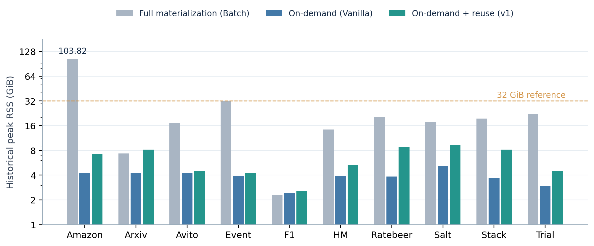
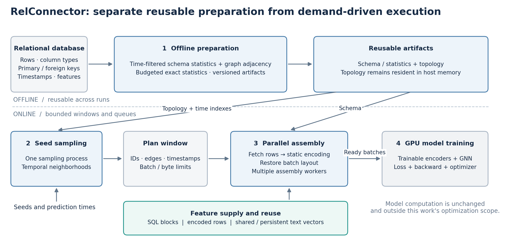
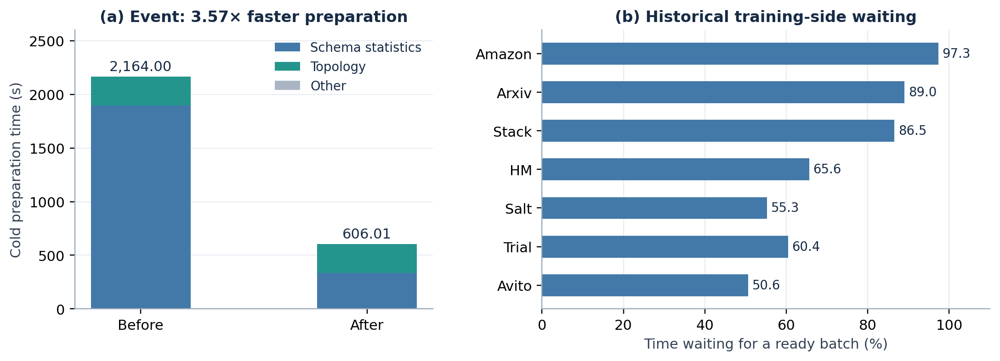
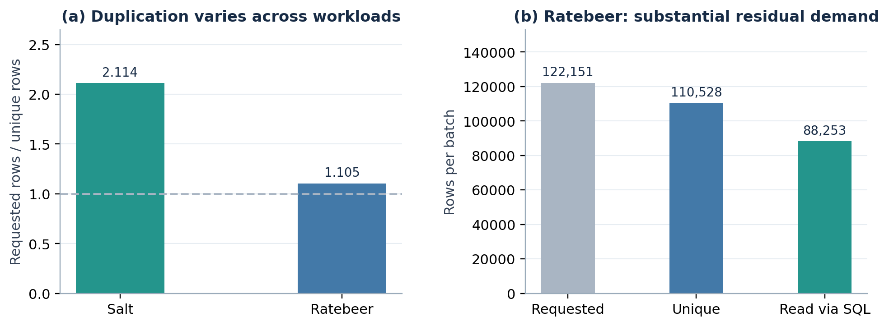
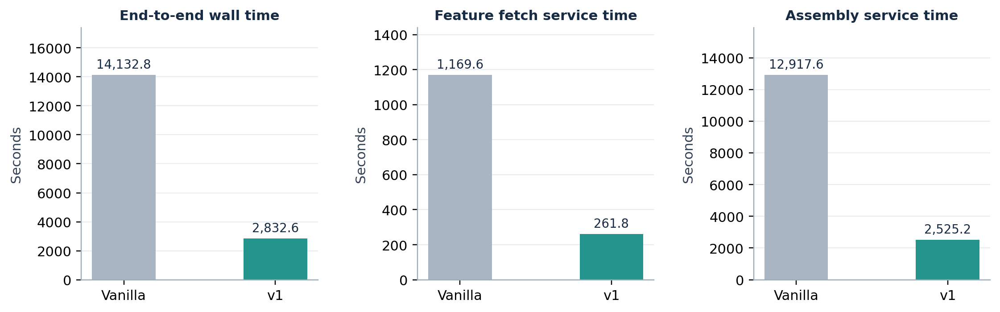
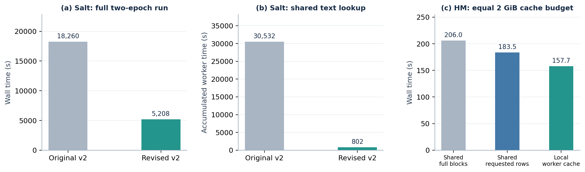

# RelConnector：面向大规模关系表格学习的按需数据准备与自适应训练流水线

论文片段：背景、动机与方法｜2026-09-27

## 1 背景：从关系数据库到可训练的关系表格表示

### 1.1 为什么需要直接学习表之间的关系

关系数据库中的预测信息通常分散在多张表中。例如，预测用户是否流失，既需要用户属性，也可能需要其历史交易、交易对应的商品属性，以及商品所属类别的信息。这些信息通过主键与外键连接，具有不同的时间尺度和一对多关系。将任务转化为单张固定宽度的特征表，需要预先选择连接路径、聚合函数和时间窗口；这一过程不仅依赖人工经验，也预先限定了模型能够利用的关系上下文。

关系深度学习将数据库中的行表示为节点，将主键与外键之间的关联表示为边，并通过不同的节点类型、边类型和时间信息保留数据库结构。模型从目标实体出发，在相关表之间传播和聚合信息，使跨表特征组合成为可学习过程。其价值不仅是减少人工特征工程，还在于使同一套建模接口能够处理来自不同业务领域、具有不同关系结构的预测任务。[1](https://proceedings.mlr.press/v235/fey24a.html)

对于带有预测时间的任务，关系表示还必须满足时间约束：模型只能使用预测时刻之前允许观察的信息。因而，关系表格学习的数据准备并非一次普通的表连接，而是将关系结构、异构属性、任务目标和时间可见性共同转化为模型输入的过程。系统优化必须保留这些语义，不能通过减少邻居数量、隐藏部分特征或引入未来信息来换取吞吐。

### 1.2 数据集与统一训练框架解决了什么问题

RelBench 为关系深度学习提供公开数据库、预测任务和评估协议，使模型能够在多个真实关系场景中进行可重复比较。它建立了从数据库结构到预测任务的共同接口，为研究关系建模效果提供了基础。本文使用的十个本地数据集属于实验环境中的数据库集合，不将其数量等同于 RelBench 最初论文的七个数据库。[2](https://proceedings.neurips.cc/paper_files/paper/2024/hash/25cd345233c65fac1fec0ce61d0f7836-Abstract-Datasets_and_Benchmarks_Track.html)

ReDeLEx 进一步统一数据库接入、属性模式、预测任务以及多类关系学习模型，支持结构化查询语言（SQL）数据源，并在七十余个关系数据库上组织模型研究。其训练流程已经包含邻域采样和时间约束。因此，关系学习领域并不缺少小批次训练接口；仍需解决的问题是，这些接口背后的数据读取、特征物化和执行调度能否在有限主机内存下保持可接受的训练吞吐。[3](https://arxiv.org/html/2506.22199v1)

这一差别可以从实现中具体观察。在本次审阅的 ReDeLEx 版本中，数据库构建路径对每张表执行全列查询，并将结果读入内存表对象 DataFrame；随后，图构建路径为各表调用特征物化操作，将生成的类型化特征张量容器 TensorFrame 挂载到图对象。这条路径便于统一建模，但其主机内存需求随表数据和物化特征增长。这里的判断针对指定版本的实现路径，不是将“不能扩展”作为 ReDeLEx 论文的结论，也不是否认其已有的邻居采样支持。[4：数据库加载实现](https://github.com/jakubpeleska/redelex/blob/3d1b392d90de6f6bf8acbac2d539d6fbaf3f32fa/redelex/datasets/db_dataset.py#L100-L140)、[4：特征物化实现](https://github.com/jakubpeleska/redelex/blob/3d1b392d90de6f6bf8acbac2d539d6fbaf3f32fa/redelex/data/graph.py#L57-L134)

### 1.3 从已有图训练系统中得到的启示

图学习系统已经说明，仅优化图形处理器上的模型计算不足以保证端到端性能。SALIENT 联合优化邻居采样、特征切片和数据传输，并通过流水线减少设备等待；BGL 则表明，数据准备阶段之间的资源竞争也会抵消并行收益。这些工作启发我们将训练看作连续的数据生产和消费过程，而非单独的模型执行过程。[5](https://proceedings.mlsys.org/paper_files/paper/2022/file/afacc5db3e0e85b446e6c7727cd7dca5-Paper.pdf)、[6](https://www.usenix.org/system/files/nsdi23-liu-tianfeng.pdf)

另一方面，Ginex 利用采样结果组织后续特征访问，以改善固态硬盘上的图训练；MariusGNN 将数据布局、采样与存储层级协同设计，支持图数据超出内存的训练。这些工作说明，采样结果不仅是模型的输入结构，也能够指导数据访问和缓存管理。[7](https://arxiv.org/pdf/2208.09151)、[8](https://arxiv.org/pdf/2202.02365)

RelConnector 聚焦于关系数据带来的额外数据准备开销：SQL 行读取和解码、类型转换、类别与数值统计、静态文本编码，以及多表特征向小批次张量的重建。我们沿用已有采样内核和模型，研究如何将这些操作从全表物化改为按需执行，并根据实际工作负载选择复用和并行策略。本文不主张首次提出小批次图训练、磁盘特征缓存或流水线，也不将当前实现描述为图拓扑完全外存化的训练系统。

## 2 动机：容量问题解决之后，数据准备成为关键路径

### 2.1 小批次模型训练并不意味着小批次数据加载

需要区分两个独立问题：每次模型更新使用多少训练样本，以及训练开始前需要在主机中保留多少数据。即使模型采用邻居采样和小批次更新，如果所有原始表和编码特征仍在初始化时完整物化，主机内存仍可能成为训练的前置限制。

本文将完整物化基线记为 Batch（全量物化）。这个名称指其数据准备方式，并不表示它使用全批次梯度下降。Vanilla 是直接按需读取和编码的初始实现；v1 是基于单进程的数据准备优化版本，通过节点去重、跨批次窗口、缓存复用和进程内线程流水线减少重复读取与编码。实际训练进一步暴露出 assemble（特征读取、编码与批次组装）的供给瓶颈：即使减少重复工作，数据准备仍可能跟不上 GPU 消费。v2 因此升级为多进程架构，将采样、assemble 和训练拆分为独立的执行阶段，分别由采样进程、组装进程池和训练主进程承担，通过有界队列连接并重叠执行。这里的单进程不等于单线程，多进程也不改变邻居采样与模型训练的算法语义。

历史实验表明，这一容量问题具有实际影响。Amazon 的 Batch 峰值常驻内存为 103.82 GiB，v1 为 7.23 GiB；Event 则分别为 31.93 GiB 和 4.24 GiB。常驻内存（Resident Set Size，RSS）反映进程实际驻留在物理内存中的页面。在一个以 32 GiB 主机内存为目标的环境中，前者已明显超出容量，后者也几乎不给操作系统和其他组件留下余量。图 1 中的 32 GiB 是容量参照线，而非一次实际限制为 32 GiB 的实验。[S1](../../gpu-feature-optimization-experiment.md)

图 1. 全量物化与按需加载的历史峰值常驻内存，纵轴为对数刻度。数据来自相同历史实验系列，未使用内存容量估算值。Vanilla 的 Amazon、Arxiv、Avito、HM、Ratebeer，以及 v1 的 Ratebeer 为超时终止前的观测峰值。Arxiv 和 F1 也说明，增加缓存并不保证每个数据集都比全量物化省内存。v2 当前日志只报告主进程的峰值，不能代表整个多进程作业，因此未将其纳入本图。

按需加载将大量特征从常驻状态转化为训练中的动态工作集，减轻了容量压力，却引入了重复读取、重复编码和逐批组装开销。我们的系统研究由此提出第二个问题：在不恢复全量特征常驻的前提下，能否让数据生产速度持续匹配模型的消费速度？

### 2.2 四阶段划分与优化边界

我们将任务生命周期划分为四个逻辑阶段，如图 2 所示。第一阶段完成可复用的离线准备：解析表结构、构建主外键图及时间索引、计算编码所需的统计量。第二阶段根据种子节点及其预测时间采样邻域，生成包含节点、边和时间上下文的采样计划。第三阶段根据计划读取缺失行、执行静态特征转换，并恢复模型所需的小批次结构。第四阶段在图形处理器上执行可训练特征编码器、图神经网络、损失计算、反向传播和参数更新。

图 2. RelConnector 的整体架构。阶段 1 的产物可独立生成并跨运行复用；阶段 2、3、4 在线重叠执行。采样计划只描述需求，组装进程按需获取和编码特征。图拓扑仍驻留在主机内存中。队列和缓存的预算约束其管理的数据，不是整个作业常驻内存的严格上限。

其中，静态特征转换是由固定编码规则确定的数据处理，例如类别编号、数值转换和冻结的文本向量计算；可训练的特征编码器则随模型参数更新，属于第四阶段。PyTorch Frame 对异构表格特征和模型组件的模块化表达为这一接口提供了基础，但 RelConnector 的缓存仅复用静态结果，不缓存依赖当前模型参数的中间表示。[9](https://arxiv.org/abs/2404.00776)

“离线”表示阶段 1 不依赖当前训练批次或模型参数，并不意味着首次运行没有成本。当前入口在缺少有效缓存时仍需执行准备操作。因此，一次冷启动的总时间应写为“离线准备时间 + 在线训练时间”，复用准备产物的后续运行则应单独报告加载成本。将两种状态混合比较，会把缓存复用误判为算法提速。

### 2.3 观察一：宽表统计主导冷初始化

Event 的一次独立冷初始化耗时 2,164.00 秒，其中特征模式与统计量构建耗时 1,895.62 秒，占 87.60%；拓扑构建为 267.95 秒。进一步的列级分析发现，events 表实际参与任务的 95 个数值列合计消耗 1,745.12 秒，占总初始化的 80.64%。旧路径为各列重复扫描并计算均值与标准差，再通过排序求精确分位数，同时存在逐值解释器处理。该结果将瓶颈定位到“宽表上的重复统计操作”，而不是笼统的“图太大”。[S2](../../v2-event-initialization-20260927.md)

### 2.4 观察二：采样规模与重复结构决定后续工作量

采样决定每批需要访问哪些表、多少行以及多少重复实体。相同的种子批量和邻居上限，并不会产生相同的特征工作量。历史记录中，Salt 的请求行数与唯一行数之比为 2.114，而 Ratebeer 仅为 1.105；Ratebeer 每批平均请求 122,151 行，去重后仍有 110,528 行，考虑原始行缓存后仍需通过 SQL 读取约 88,253 行。图 4 展示了这种差异。[S1](../../gpu-feature-optimization-experiment.md)、[S3](../../bottleneck-analysis-and-optimization.md)

这一观察揭示两个不同限制。高重复负载需要避免将逻辑上的多次出现转换为物理上的重复读取和编码；低重复、大邻域负载则确实有大量不可复用的工作，仅扩大缓存不能消除这些需求。同时，采样如果无限领先于组装，尚未消费的计划和特征也会积累，侵蚀按需加载的内存收益。

现有证据能够说明采样产生的需求对下游吞吐的影响，但尚不足以证明采样内核本身是 v2 的主要加速来源。我们的优化保留现有邻居采样实现，重点改进采样计划的执行边界、需求复用和预取约束。

### 2.5 观察三：特征生产速度低于训练消费速度

历史诊断中，Amazon、Arxiv 和 Stack 的训练端分别有 97.3%、89.0% 和 86.5% 的时间等待就绪批次。对于 Arxiv，组装累计时间为训练阶段墙钟时间的 97.1%，特征读取为 2.9%；Avito 的对应关系几乎相反，读取为 90.9%，组装为 8.4%。因此，瓶颈既可能是数据库读取与解码，也可能是读取之后的文本处理与张量构造，不能统一归结为磁盘速度。[S3](../../bottleneck-analysis-and-optimization.md)

图 3. 左：Event 在独立空初始化缓存下的前后对照，组件为不重叠的准备阶段耗时。右：历史训练端等待就绪批次的比例，属于早期瓶颈定位证据；原诊断文档注明其来自后续正确性修订之前，不能作为当前实现的最终性能或精度结论。等待比例不等于硬件监测得到的图形处理器空闲比例。

还需要区别墙钟时间与服务时间。墙钟时间表示用户实际等待多久；各工作进程的服务时间表示它们累计做了多少工作。并行操作可以重叠，操作内部也可以嵌套，因而不能将采样、读取、组装和模型步骤的累计计时简单相加。本文优先使用训练端等待定位供给不足，再用操作计时和访问计数解释原因。

### 2.6 从单进程复用到成本感知并行

Vanilla 暴露的首先是重复劳动：同一行或相同文本在不同逻辑位置和相邻批次中反复处理。v1 通过节点去重、跨批次特征窗口和文本缓存利用这类复用，但仍受单进程内特征生产吞吐限制。v2 因而将组装扩展到多个独立进程。

实际运行又表明，多进程并不是优化的终点。Salt 的早期 v2 虽然文本缓存命中率约为 99.93%，完整两轮仍耗时 18,260.23 秒，其中训练端等待就绪批次约 16,405.1 秒。瓶颈已经由“重复计算文本向量”转向“为每次命中支付查询与同步成本”。HM 同样在 article 特征缓存命中率达到 99.77% 时发生退化：共享缓存返回整个特征块，导致大量跨进程传输和对象重建。[S4](../../v2-salt-regression-20260926.md)、[S5](../../v2-hm-regression-20260925.md)

因此，本文的方法遵循三个递进原则：首先分离不随训练变化的工作，避免重复初始化；其次根据采样需求消除不必要的数据生产；最后使并行和缓存策略适应实际复用率、访问成本及队列状态。策略的依据是工作负载特征，而非数据集名称。

## 3 系统设计：分离计划、特征与模型执行

### 3.1 执行架构

v2 使用一个采样进程生成计划，并由多个长期存活的组装进程消费计划窗口。每个组装进程持有自己的数据库连接和必要的编码状态，将完成的小批次放入就绪队列；训练进程从该队列获取输入并执行模型。只读拓扑张量通过共享存储供采样使用，避免将完整拓扑作为每批消息反复传递。

计划与特征分离具有两个作用。第一，采样不需要等待每一批完成文本编码后才继续推进，使阶段之间能够重叠。第二，系统在读取特征之前就获得了明确的行需求，可以合并相邻批次的物理访问，同时保留每批独立的图结构。图 2 中的计划窗口就是这一优化的边界。

若一次任务包含 N 个批次，采样、组装和模型步骤的平均服务时间分别为 s、a、g，在忽略启动、尾部和资源竞争的理想条件下，使用 p 个组装进程的在线时间可近似理解为 N × max(s, a/p, g)。实际系统还需支付通信、同步及不均衡开销，组装也不一定能线性扩展。这个表达式用于说明优化方向：提高已经不在关键路径上的阶段速度，不能等比例降低端到端时间；增加进程数也必须以减少训练等待为依据。

### 3.2 控制在途数据，而非无限预取

关系图的小批次大小随邻域变化明显，只限制队列中的批次数不足以控制内存。因此，v2 同时约束计划窗口的批次数和字节数、在途窗口数，以及计划和就绪队列所保留的张量存储。下游消费不足时，预算约束会阻止上游继续无界生产。

现有实现默认一个窗口最多容纳四个批次，并设置窗口字节预算；窗口在训练轮次边界拆分。下一轮可以作为独立窗口预取，但训练端保留轮次边界，避免跨轮混合消费。就绪优先模式在同一轮内选择已经准备好的批次，减少等待较慢批次造成的队首阻塞；严格顺序模式则按照预定序列消费，适合需要控制更新顺序的比较。

这些预算控制的是系统管理的缓存与在途载荷。总主机内存还包括常驻拓扑、进程与模型状态、数据库解码缓冲及分配器开销，不能由队列预算直接推导。当前实现仍要求拓扑适合主机内存；它主要移除了全量特征常驻这一容量限制。

### 3.3 保留训练语义

采样继续使用现有的异构时序邻居采样内核，保留任务的种子节点、时间可见性与邻居配置。随机状态由训练轮次、批次和采样分支等信息确定，以降低并行执行对采样随机性的干扰。

特征复用只合并物理读取与静态编码，不合并图中的逻辑节点实例。例如，同一数据库行可能出现在两个不同预测时刻的种子邻域中；它们可以复用相同的静态属性，但各自的邻接关系、时间约束和批次位置必须保留。就绪优先模式可能改变同一轮内的参数更新顺序，因此不能据此宣称与串行训练逐位等价；完整的精度评估仍需使用明确的顺序配置和重复实验。

## 4 阶段一：预算驱动的离线初始化

### 4.1 将全表特征物化改为必要元数据准备

初始化保留模型和采样真正需要的全局信息：表及列的类型描述、类别与数值统计、主外键映射、邻接结构以及时间属性。原始特征行留在数据库中，编码后的完整特征表也不在这一阶段生成。这样，阶段一的产物面向“如何采样和如何编码”，而不是预先准备所有可能用到的特征。

统计量使用规定的时间截断与隐藏列配置，避免将预测目标或不可见数据引入输入。准备产物持久化后，后续任务在兼容配置下直接加载。当前模式缓存键包含数据库路径、大小、修改时间、时间截断、隐藏列、算法版本及相关编码配置；数值统计策略升级时更新版本，防止旧产物被当作新算法结果。该校验依赖数据库版本管理，不等价于对数据库内容逐字节哈希。

### 4.2 宽表的分组扫描与精确分位数选择

Event 的瓶颈来自大量数值列重复经过数据库扫描、排序和解释器循环。v2 因此根据可用数值缓冲预算选择执行路径，而不对 Event 设置特殊分支。

对于满足时间条件、包含 n 行的表，以每个数值 8 字节估算一列双精度缓冲的大小。设预算为 B，则一次处理的列数为 min(32, floor(B / (8n)))，再受剩余列数约束。默认 B 为 128 MiB。当至少一列能够放入预算时，将多个数值列投影到同一次读取中，并以最多 8,192 行为一块解码，减少逐列扫描开销。

对读取后的每列保留有限数值，计算均值和标准差。分位数通过原地选择操作定位所需的顺序统计量，而不对整列作完整排序。具体而言，对分位点 q 和 m 个有效值，目标位置为 (m−1)q；取其向下和向上取整位置的值，并按小数部分线性插值。这与原来的精确分位数语义一致，不引入抽样近似。方差计算的临时差值数组也按块处理，避免额外复制整列。

若单列本身超过预算，系统回退到流式统计和数据库排序路径，并用批量过滤与索引提取分位点，减少逐值处理。由此，宽而可容纳单列的数据能够受益于分组扫描，极长列仍有可执行的回退路径。128 MiB 仅约束数值缓冲，不包括数据库、DataFrame 和拓扑占用。

### 4.3 结果与剩余瓶颈

在两个独立空初始化缓存目录下，Event 的准备时间由 2,164.00 秒降至 606.01 秒，减少 72.0%，加速约 3.57 倍；其中模式与统计阶段由 1,895.62 秒降至 335.66 秒，而拓扑构建由 267.95 秒变为 269.92 秒，基本不变，如图 3a 所示。优化针对的是数值统计路径，不能将该结果解释为图构建也获得了同样加速。[S6](../../v2-initialization-optimization-20260927.md)

新旧模式共比较 329 项统计：类别、时间统计与分位数一致，均值和标准差的最大绝对差为 7.958×10⁻¹³，通过记录中的数值容差检查。该对照包含缓存保存，不包含 Python 导入，未清除操作系统文件缓存，且是同机单次前后测量。优化后拓扑约占准备时间的 44.5%，成为下一步需要分析的组成部分。已有结果证明了 Event 冷初始化的改善；其余数据库上的收益不能在未复测时直接外推。

## 5 阶段二：语义不变的采样计划与需求压缩

### 5.1 区分逻辑出现次数与物理行数

一次采样产生的是图中的逻辑节点实例，数据库读取需要的却是物理行。设某表在一个计划窗口中的行标识序列为 I，唯一行标识集合为 U，并构造位置映射 r，使 I 中第 j 个位置对应 U 中第 r(j) 行。系统只为 U 获取和编码一次静态特征，再通过 r 恢复每个批次要求的顺序和重复位置。

这一过程减少的是数据生产工作，不改变采样结果。对于跨表数据，去重键必须包含表类型及行标识；对于跨任务或不同数据库版本，缓存必须使用相应的版本和编码上下文。不能因为两个节点的数值标识相同就将其合并，也不能因为静态特征相同就合并它们的时序邻域。

图 4. 历史工作负载的需求特征。左：请求行数相对唯一行数的放大倍数；右：Ratebeer 每批平均的请求量、唯一行数和 SQL 读取量。右侧指标为早期诊断计数，展示低复用负载的剩余工作量，不代表当前 v2 的采样内核耗时。

Salt 的 2.114 倍重复因子意味着，按该统计口径，在请求范围内去重可消除约 52.7% 的重复行工作；Ratebeer 的 1.105 倍则仅对应约 9.5%。这解释了为什么相同的去重机制在不同数据库上收益相差很大。它也解释了为什么不应把所有慢任务都交给更大的缓存：对于低复用任务，优化目标应转向剩余唯一行的读取、转换和并行执行。

### 5.2 用短窗口扩大复用范围

仅在单个批次内去重会遗漏相邻批次的共享实体。v1 引入短特征窗口，将多个采样计划的需求合并后读取与编码，再分配回各批次；v2 延续这一机制，并把窗口作为多进程组装的工作单元。窗口同时受批次数和字节数约束，以控制首批等待时间和临时工作集。

历史 Salt 运行中的 794 个窗口平均包含 3.992 个批次，原始行缓存覆盖率达到 98.70%。这说明其数据访问具有可以利用的局部性。相反，Ratebeer 即使使用行缓存，仍有约八万八千行每批需要数据库读取。因此，窗口合并提供统一的机制，实际收益由工作负载决定，而不是预先假设所有数据库都有相同局部性。[S1](../../gpu-feature-optimization-experiment.md)

### 5.3 解耦采样与组装，但不盲目扩张采样并行度

v2 将采样放入独立进程，使其输出计划而非已经编码的特征批次。采样可以与组装重叠，但始终受在途计划预算约束。当前实现使用单个采样进程，未实现多个采样进程之间的负载均衡，也未替换底层采样算法。

这一选择来自瓶颈定位：在组装供给不足时，优先增加采样并行度只会更快地产生尚未处理的需求。只有当后续测量确认计划供给不足、而组装和训练持续等待采样时，才有依据进一步优化采样内核。现有阶段二的贡献应表述为“需求显式化、物理访问去重和有界预取”，其收益通过后续读取和组装成本体现，不能虚构一个独立的采样加速倍数。

## 6 阶段三：成本感知的特征编码与批次组装

### 6.1 v1：先避免重复读取和重复编码

Vanilla 的按需路径对每批需求执行读取、转换和组装。虽然原始行缓存与异步执行已经存在，但逻辑重复节点、相邻批次的共享行和重复文本仍可能触发重复处理。v1 将唯一行读取、特征窗口和文本向量缓存结合，使数据库行与冻结编码结果能够跨逻辑位置复用。

在数据库访问层，系统先按行标识所属块组织唯一行请求，再根据块内请求密度选择读取方式。当前默认密度阈值为 25%：请求集中时读取整块并保留在原始行缓存中，请求稀疏时使用分组行标识查询，避免为了少量行读取大量无关数据。查询只投影任务需要的特征列，命中块缓存的行不再访问数据库。该启发式权衡查询次数与读取放大，适用于不同表的访问密度，而非按数据库名称固定选择。

Salt 为这一机制提供了代表性证据。在相同的 3,170 个历史训练批次下，端到端时间由 14,132.8 秒降至 2,832.6 秒；特征读取累计时间由 1,169.6 秒降至 261.8 秒，组装由 12,917.6 秒降至 2,525.2 秒，如图 5 所示。约 4.99 倍的端到端改善来自这一组复用机制的组合，现有对照不能将全部收益单独归给其中某一个缓存。[S1](../../gpu-feature-optimization-experiment.md)

图 5. Salt 的历史同规模结果。端到端时间与两个操作累计时间分别绘制，因为异步执行导致操作之间重叠，后两者不能堆叠为端到端时间。这组记录用于解释 v1 的设计动机；历史报告仍保留数值等价性未完全验收的说明。

### 6.2 v2：并行执行不可复用的剩余工作

去重和缓存只能消除重复工作。对首次出现的行和文本，系统仍需执行 SQL 读取、解码、静态编码以及 TensorFrame 构造。v2 使用多个长期存活的组装进程处理不同窗口，从而并行执行这些剩余任务，并降低单个进程中 Python 对象处理和编码路径对供给速度的限制。

并行度由供需状态辅助调整：训练端缺少就绪批次、且计划队列仍有任务时，系统可以激活更多已有组装进程；就绪队列占用超过其预算的 75% 时，则减少活跃组装进程。该机制调整已有进程的工作许可，不会自动释放它们已经持有的全部内存。最大进程数仍由配置限制，已有 HM 对照也表明八个进程不必优于四个进程。[S5](../../v2-hm-regression-20260925.md)

因此，v2 的目标是提高有效数据供给，而不是最大化工作进程数。对短任务，初始化和进程启动可能占主导；对读取密集任务，并发可能受数据库和存储带宽限制；对组装密集任务，更多进程才可能有效降低训练等待。

### 6.3 高复用文本：共享向量与本地位置索引分离

共享文本缓存可以避免不同进程重复编码相同文本，但一次命中仍需查找、协调和复制结果。若每批有大量重复文本，跨进程查询本身就会成为主要成本。Salt 的早期 v2 中，四个工作进程的共享文本查询累计约 30,532 秒，而文本模型编码累计仅约 32 秒。继续提高命中率或增加磁盘缓存都无法针对这一问题。[S4](../../v2-salt-regression-20260926.md)

v2 为此将“保存向量”和“定位向量”分开。向量仍保存在共享存储中，各工作进程仅维护文本到已发布共享槽位的位置索引。索引命中后直接批量读取对应向量，绕过重复的共享哈希查找和跨进程协调。首次编码仍通过共享预留机制协调，避免多个进程同时计算同一缺失文本。已经发布的槽位在本次运行内保持稳定，返回值复制到独立张量，防止调用方修改缓存内容。

本地索引不是始终开启。每个工作进程先观察至少 64 次调用和 1,024 个请求；当共享命中率至少为 80%，且该观察窗口累计查询时间不少于 5 毫秒时，才启用索引。启用后给予两个窗口建立局部性；此后若连续两个窗口的本地命中率低于 20%，则清空索引并进入冷却期，重复低收益切换会延长冷却。每个工作进程的索引元数据估算预算为 32 MiB，超限时按最近最少使用策略淘汰条目。

这组规则同时检查“是否有可复用数据”和“复用查询是否足够昂贵”。它既能在 Salt 上保留本地索引，也能在复用不足时关闭索引，而不需要判断数据集名称。图 6 展示共享查询批量化与自适应位置索引联合修复后的结果：Salt 的完整两轮时间由 18,260.23 秒降至 5,208.23 秒，共享查询累计时间降至 802.46 工作进程秒，文本模型输入数量保持一致。这是相对早期 v2 的约 3.51 倍改善，不能当作相对 v1 的加速。[S4](../../v2-salt-regression-20260926.md)

图 6. 高命中率缓存仍可能成为瓶颈。Salt 两图分别报告墙钟时间和工作进程累计服务时间，量纲含义不同，不能相加。Salt 前后包含共享查询批量化及自适应索引的联合变化。HM 对照固定编码特征缓存总预算为 2 GiB、训练 1,000 个批次并复用初始化缓存，用于分离传输范围与缓存位置的影响。

### 6.4 高复用结构化行：减少命中后的传输与重建

仅缓存文本向量仍会重复执行类别、数值及 TensorFrame 组装。对频繁访问的维表行，缓存完整静态编码结果可以绕过更多工作。但共享编码缓存也可能把一次小范围请求放大为整块特征传输。

HM 的定向对照说明了这一代价。在相同 2 GiB 总预算下，原共享缓存耗时 206.0 秒；仅返回实际命中行后降至 183.5 秒；将编码缓存放到工作进程本地后进一步降至 157.7 秒。对应 article 查询累计计时由 148.6 秒降至 58.6 秒，再降至约 3.8 秒。收益来自更短的命中路径，而非扩大容量。[S5](../../v2-hm-regression-20260925.md)

共享与本地缓存具有不同取舍：共享有利于跨进程复用，本地则减少协调、传输和对象重建，但可能保存重复数据。当前系统提供这两类配置，并对缓存插入采用复用感知的准入策略，避免低复用流式行不断挤出热点。HM 最终完整实验使用的本地总计 4 GiB 缓存是显式实验配置，不能将这一选择描述为系统已经自动学会了缓存部署位置。

### 6.5 大文本工作集：在需要时启用持久化编码缓存

另一类任务的主要问题是文本工作集超过内存缓存容量。早期 Arxiv 诊断中，97.33 百万次文本出现仍导致 36.93 百万次模型输入和 36.48 百万次淘汰；局部内存复用不足以保留训练中可能再次遇到的向量。此时需要把已经计算的冻结文本结果保存到更大的持久化存储，而不是只优化命中路径。[S3](../../bottleneck-analysis-and-optimization.md)

v2 根据数据库大小、已发生的编码工作量、内存命中率和编码累计耗时判断是否启用磁盘文本缓存。默认配置要求数据库至少为 256 MiB，累计模型输入至少 4,096 条、编码至少消耗 1 秒，且内存命中率不高于 10%；若存在兼容的持久化缓存，则可以直接复用。缓存命名空间包含数据库版本、模型标识、执行模式与向量维度，避免不同编码上下文混用结果。该缓存保存冻结文本向量，不保存随梯度更新的表示。

这一机制的收益与缓存状态密切相关。Arxiv 的同规模 100 批次对照中，不使用磁盘缓存为 204.7 秒，复用磁盘缓存为 190.5 秒，而首次创建缓存为 396.6 秒。它说明持久化可以减少重复编码，但首次写入也有成本。完整 v2 中观察到的 Arxiv 吞吐改善同时包含多进程执行、其他组装优化、预先存在的缓存以及训练轮次差异，不能将其全部归因于磁盘缓存。[S7](../../v2-disk-text-cache-experiment-20260925.md)

### 6.6 按工作负载性质选择策略

表 1 将上述机制归纳为可观察的工作负载性质。数据集用于说明现象，不作为算法分支条件；同一数据库也可能同时具有多种性质。

| 工作负载性质 | 主要证据或信号 | 主要机制 | 代表性观察与边界 |
| --- | --- | --- | --- |
| 数值列多、初始化占比高 | 重复列扫描及精确统计耗时 | 预算内分组读取、原地精确选择、超预算回退、产物复用 | Event 冷准备 2164.00→606.01 秒；拓扑基本未变 |
| 重复实体和文本密集 | 请求行与唯一行之比高，内存命中高 | 窗口去重、静态编码复用；高成本命中启用本地位置索引 | Salt：v1 先消除重复工作，v2 再降低共享查询成本 |
| 热点维表重复访问 | 编码行命中高，传输及重建昂贵 | 只传请求行；可配置本地编码缓存 | HM 同预算对照 206.0→157.7 秒；部署位置尚非全自动 |
| 文本工作集大于内存缓存 | 持续淘汰、实际编码输入多 | 多进程组装；有条件启用持久化文本向量 | Arxiv 等；必须区分首次创建与复用成本 |
| 邻域大而复用低 | 去重后仍有大量唯一行 | 有界窗口、按需读取、并行处理剩余工作 | Ratebeer；不能期望扩大缓存消除真实读取量 |
| 读取与解码占主导 | 读取服务时间高于编码组装 | 合并读取、块访问与精确行访问选择、并行重叠 | Avito 的历史诊断；仍需独立消融量化各项收益 |
| 训练批次很少 | 固定准备和启动时间占比高 | 复用离线产物，控制并行开销 | F1、Event 的短在线阶段；不承诺多进程必然更快 |

表 1. 从工作负载特征到系统策略的映射。表中描述已实现机制或明确的实验配置，未将待实现的自动缓存部署、全图外存采样写成当前能力。

## 7 方法小结与后续实验应回答的问题

RelConnector 的主线是重新组织关系学习中的数据准备：把与模型更新无关的图结构和统计工作前移到可复用的离线阶段；把采样结果表示为有界、可合并的特征需求；再通过多进程组装和成本感知缓存，将这些需求转化为模型批次。其目标是在避免全量特征常驻的同时，减少模型等待输入的时间。

这条主线能够解释不同任务的收益差异。Event 的核心问题首先是冷初始化，必须同时讨论精确统计优化和产物复用；Salt 的主要收益首先来自 v1 的重复工作消除，v2 进一步处理高频共享查询；Arxiv 一类任务需要提升剩余文本处理的并行吞吐，并利用合适的持久化复用。对于 Ratebeer 一类低复用负载，较低的重复因子限制了缓存收益，其优化重点是剩余数据生产路径，而不能用“命中率提高”概括。

后续完整实验应在统一硬件、训练工作量和缓存状态下验证这些机制，包括冷启动与复用启动、固定批次数的组件消融、不同内存预算下的吞吐，以及严格顺序与就绪优先模式的模型效果。当前历史 v1 与 v2 实验存在硬件、轮次和缓存状态差异，适合用于提出瓶颈假设和观察趋势，尚不足以直接给出严格的跨版本因果结论。

尤其需要修正两个容易误读的口径。第一，v2 当前主进程峰值不能替代整个进程组的内存占用；应补测作业级峰值或考虑共享页归属的进程组指标。第二，历史 Ratebeer 的 v1 在四小时内完成 15,686/20,743 批次，而 v2 的 20,000 批次来自两轮各上限 10,000 批次，总耗时 15,444.93 秒；它不是在同一四小时预算内完成同一完整轮次。因此，不能据此宣称“前两个版本超时，只有 v2 在相同限制下完成”。[S8](../../v2-ratebeer-regression-20260926.md)

现有证据最有力地支持的结论是：按需加载缓解全量特征的容量需求，但需要以真实的初始化、需求重复性和缓存访问成本为依据组织训练。系统优化的对象不仅是缓存未命中与编码计算，也包括命中路径、数据布局和阶段之间的供需关系。

## 参考文献

[1] Fey, M., et al. Position: Relational Deep Learning — Graph Representation Learning on Relational Databases. ICML, 2024. [来源](https://proceedings.mlr.press/v235/fey24a.html)

[2] Robinson, J., et al. RelBench: A Benchmark for Deep Learning on Relational Databases. NeurIPS Datasets and Benchmarks, 2024. [来源](https://proceedings.neurips.cc/paper_files/paper/2024/hash/25cd345233c65fac1fec0ce61d0f7836-Abstract-Datasets_and_Benchmarks_Track.html)

[3] Peleška, J., and Šír, G. ReDeLEx: A Framework for Relational Deep Learning Exploration. 2025. [来源](https://arxiv.org/abs/2506.22199)

[4] ReDeLEx source implementation, commit 3d1b392d90de6f6bf8acbac2d539d6fbaf3f32fa. Accessed 2026-09-27. [来源](https://github.com/jakubpeleska/redelex/tree/3d1b392d90de6f6bf8acbac2d539d6fbaf3f32fa)

[5] Kaler, T., et al. Accelerating Training and Inference of Graph Neural Networks with Fast Sampling and Pipelining. MLSys, 2022. [来源](https://proceedings.mlsys.org/paper_files/paper/2022/file/afacc5db3e0e85b446e6c7727cd7dca5-Paper.pdf)

[6] Liu, T., et al. BGL: GPU-Efficient GNN Training by Optimizing Graph Data I/O and Preprocessing. NSDI, 2023. [来源](https://www.usenix.org/system/files/nsdi23-liu-tianfeng.pdf)

[7] Park, Y., Min, S., and Lee, J. W. Ginex: SSD-enabled Billion-scale Graph Neural Network Training on a Single Machine via Provably Optimal In-memory Caching. PVLDB 15(11), 2022. [来源](https://arxiv.org/abs/2208.09151)

[8] Waleffe, R., Mohoney, J., Rekatsinas, T., and Venkataraman, S. MariusGNN: Resource-Efficient Out-of-Core Training of Graph Neural Networks. EuroSys, 2023. [来源](https://arxiv.org/abs/2202.02365)

[9] Hu, W., et al. PyTorch Frame: A Modular Framework for Multi-Modal Tabular Learning. 2024. [来源](https://arxiv.org/abs/2404.00776)

## 本地实验来源

[S1] [历史 Batch / Vanilla / v1 对照与 Salt 分解](../../gpu-feature-optimization-experiment.md)。

[S2] [Event 优化前独立冷初始化](../../v2-event-initialization-20260927.md)。

[S3] [早期瓶颈诊断（正确性修订前，限用于动机）](../../bottleneck-analysis-and-optimization.md)。

[S4] [Salt 共享查询与自适应索引修复](../../v2-salt-regression-20260926.md)。

[S5] [HM 缓存位置与传输范围对照](../../v2-hm-regression-20260925.md)。

[S6] [Event 数值统计优化与一致性检查](../../v2-initialization-optimization-20260927.md)。

[S7] [Arxiv 磁盘文本缓存冷、热对照](../../v2-disk-text-cache-experiment-20260925.md)。

[S8] [Ratebeer 完整记录及批次数口径](../../v2-ratebeer-regression-20260926.md)。
